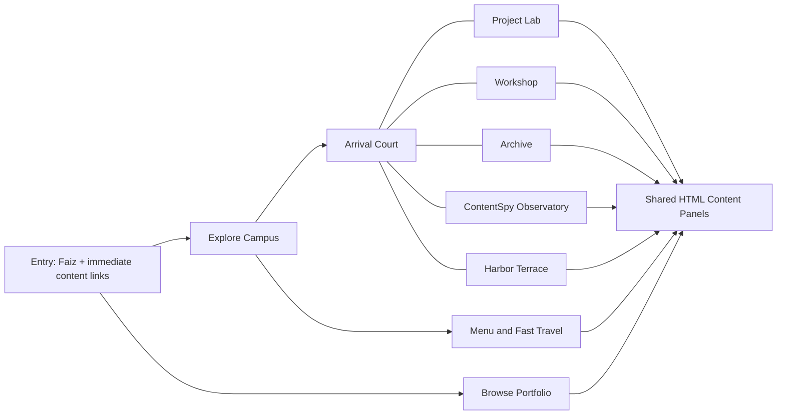

# Faiz Kerawala — Persona 3 Reload inspired portfolio build plan

Date: October 11, 2026

Branch: `codex/persona-reload-portfolio`

Base: `main` at `4e8c164`

Status: research and planning complete; implementation has not started.

Read [research.md](research.md) for primary sources, visually inspected references, repository findings, and evidence limits. This document proposes the portfolio's original design and implementation; its colors, layouts, timings, and budgets are design choices.

## 1. The experience

**Build a small, beautifully art-directed coastal campus that visitors explore as a third-person character.** Your projects become places, menus become editorial compositions, and a top-right calendar makes the portfolio feel like a playable day in your world.

Working concept: **BLUE HOUR / FAIZ KERAWALA**. This is optional experience branding; your name and AI Engineer / Software Engineer identity remain prominent.

Picture the opening: a sunlit campus courtyard against a blue harbor, elongated shadows across pale paving, a cobalt clock tower, and an original avatar wearing headphones. A large title crosses the left side of the screen. The date sits on layered blue shapes in the upper right. An illuminated lab entrance draws the visitor toward your work. Opening a project freezes the world beneath an aqua-to-cobalt wash and reveals a white angular case-study panel.

Default direction: genuine 3D geometry, a rigged third-person avatar, a composed perspective camera, stylized materials, and HTML interface overlays. This should feel like a compact game environment with portfolio content woven into it.

## 2. Visitor journeys

### First visit

1. Show Faiz's name, role, a short value proposition, and immediate Projects, Resume, and Contact actions in the initial HTML.
2. Present **Explore Campus** and **Browse Portfolio** as clear alternatives. The world loads after exploration intent; a still illustration supplies the first view.
3. Enter exploration with a brief, skippable reveal and one unobtrusive control hint.
4. Spawn facing the project lab. First content interaction should be possible within approximately five seconds of walking.
5. Walking near an exhibit reveals `E · View FocusFlow`; activating it opens readable project details.
6. Close the panel and return to the same location and camera. Use a menu or map to visit any other destination directly.

### Visitor with limited time

Projects, Resume, and Contact are accessible from the entry screen and persistent menu. A visitor can inspect your strongest work without learning movement controls. Browsing uses the same visual language and content data as exploration.

### Returning visitor

Remember browsing preference, audio choice, quality, and last safe location in versioned local settings. Always offer a reset. Do not resume a loading state or half-completed camera transition.

## 3. Campus and content map

Use one compact outdoor hub with five destination areas. Dedicated interiors can be added later; the first release uses authored exterior vignettes and detail overlays.

| Destination | Physical character | Content and interactions |
| --- | --- | --- |
| **Arrival Court / Profile** | Clock tower, harbor view, welcome plaque, original avatar | Name, role, introduction, Ontario Tech, 3.78 GPA, Dean's List, resume. |
| **Project Lab / Projects** | Glass entrance and four distinct exhibit stations | FocusFlow attention display; short-form editor timeline exhibit; SoulSync waveform sculpture; research-agent archive terminal. Each opens its own case study. |
| **Workshop / Skills** | Shelves, instrument table, equipment display | Languages, ML/CV, AI, Agents, Frameworks, Tools & Infra. Show evidence-linked capabilities; avoid invented skill percentages. |
| **Archive / Experience** | Long gallery window and three illuminated markers | MekTek internship, Meraki client work, Ontario Tech education. Preserve real dates and outcomes. |
| **Observatory / ContentSpy** | Taller blue pavilion with a distinctive signal dish | Current ContentSpy launch teaser and contentspy.me link; retain its current public disclosure level. |
| **Harbor Terrace / Contact** | Open waterfront seating and a signal post | Email, LinkedIn, GitHub; one-click actions and optional clipboard copy with feedback. |



Keep the walkable footprint roughly 40 by 40 world units, with 1 unit approximately 1 meter. Each destination should be a 5–12 second walk from the center. Use the clock tower and harbor as orientation landmarks. Short paths and useful sightlines matter more than literal real-world scale.

## 4. Visual specification

### Palette

Proposed original tokens, not sampled or claimed official game values:

| Token | Value | Use |
| --- | --- | --- |
| Midnight | `#061841` | Menu depth, HUD backgrounds, dark text accents |
| Cobalt | `#123DE8` | Large interface fields and selected navigation |
| Ocean | `#087CEB` | Midtones and water layers |
| Aqua | `#35F2EF` | Focus cues, light, interaction markers |
| Paper | `#F5FBFF` | Detail reading surfaces and light typography |
| Ink | `#081020` | Text on paper and strong structural contrast |
| Signal | `#F8E66A` | Small wayfinding accents |
| Coral | `#FF576F` | Sparse selection accents where useful |

Do not use aqua for small text on white. Validate actual text/background combinations; aim for 4.5:1 on body copy and 3:1 on large type and interface boundaries.

### Type and shape

- Prototype display type with **Barlow Condensed ExtraBold** and restrained italic treatments; retain **Manrope** for readable body copy and **JetBrains Mono** for technical metadata. Verify font files and licenses when adding them. No claim that these are the game's fonts.
- Huge cropped decorative labels, bold stacked navigation, broad diagonal white wedges, and slim contextual labels.
- Use live HTML text. Put decorative transforms on wrappers and backgrounds; keep paragraph text upright.
- Favor angular silhouette and deliberate spacing over the existing rounded glass-card system.
- Compose project details asymmetrically: project list or category on one side, reading panel in the center, an original exhibit visual or avatar composition on the other.

### Environment

Stylized architectural realism: pale concrete, cobalt glazing, warm brick accents, ocean backdrop, long shadows, and controlled highlights. Use baked ambient lighting, a limited sun shadow, and custom painted textures. Employ toon shading selectively on the avatar and a few hero objects. A blanket cel-shading pass is not necessary for every surface.

The first art target is a finished courtyard composition and one lab exhibit. Boxes and a capsule can establish movement temporarily; they do not satisfy the finished art requirement.

## 5. HUD and menus

| Position | Element | Behavior |
| --- | --- | --- |
| Upper right | Calendar | Large `10 / 11`, smaller `SUN`, year, and time-of-day label on layered blue shapes. Use the real date. |
| Upper left | Identity and menu | Compact Faiz mark; visible Menu button; direct contact access. |
| Lower left | Map and location | Simplified campus silhouette, avatar marker, selected destination, location name. Click/tap opens fast travel. |
| Lower center | Interaction cue | One nearest eligible target, explicit action label, keyboard/touch prompt. |
| Lower right | Context controls | Movement hint, sound, quality, and browse-mode access without covering content. |

Calendar implementation: default to the visitor's local timezone and identify it in the accessible label or expanded date details. This gives visitors their actual day. Use `Intl.DateTimeFormat`; update at minute boundaries and on tab focus. Initial static HTML uses a neutral date placeholder; fill it after mounting so a static export never freezes the build date or creates a hydration mismatch. Format the full date in a semantic `time` element. A later cosmetic night mode must not change the real date.

Main menu: **Profile / Projects / Skills / Experience / ContentSpy / Contact / Settings**. Projects, Resume, and Contact remain explicit labels and shortcuts. Menu items can open content directly; map destinations offer a separate **Travel here** action.

Each project view includes title, category, problem, implementation, verified impact, stack, and repository link. Expand current copy using verified information only. Preserve the four existing projects and their metrics. Avoid adding demo buttons where no live URL exists.

Resume initially opens/downloads the existing Markdown resume with an honest file label. A designed PDF is a separate content deliverable, not an assumed existing asset.

## 6. Movement and interaction

- Desktop: WASD or arrow keys move; E or Enter activates a nearby object; Esc closes the current overlay; M opens map; a visible button opens the menu.
- Third-person camera follows a target offset with bounded rotation. Introduce area-specific camera framing gradually. No pointer lock needed for the initial version.
- Movement is camera-relative, normalized on diagonals, with acceleration/deceleration and delta-time-based updates. Clamp large deltas after tab suspension.
- Use a fixed-step movement calculation with capped substeps, plus flat walkable polygons and simple obstacle colliders. Slide along walls and prevent tunneling at corners. Restrict the first campus to one navigation elevation; stairs/rooftop visits use authored travel transitions.
- Blend original idle, walk, turn, and interaction animations. Match gait to movement speed and prevent obvious foot sliding.
- Proximity selection uses range, facing, and visibility; never interact through a wall. Only show one action at a time.
- Opening any menu or content panel stops locomotion, clears held input, and transfers keyboard focus. Closing restores the previous focus and safe camera state.
- Reset input on window blur, visibility change, touch cancellation, and overlay open. Scope shortcuts to exploration, avoiding text fields and standard browser combinations.
- Clicking an exhibit offers the same information as E. World walking and HTML menu access must reach identical data.
- Fast travel moves to a tested destination anchor with a short transition. Direct content access remains possible during travel or scene-loading failures.

Touch: offer a left-thumb joystick and explicit action button in Explore mode, with comfortable safe-area spacing and a stable camera. Also provide a destination map and full Browse mode. For small screens, default to the lightweight browsing view with an optional Explore action. Defer arbitrary ground tap-to-walk/pathfinding until basic controls are proven.

## 7. Motion and sound direction

Proposed timings: selection feedback within 80–120 ms; menu opening 250–350 ms; content reveal 300–450 ms; fast travel 450–650 ms. Input should be acknowledged immediately, and repeated actions must cancel or safely finish transitions.

Use a coordinated diagonal menu reveal, restrained rising water fragments, slow harbor movement, and subtle avatar idle. Avoid continuous movement behind reading panels. Reduced motion removes sweeps, camera drift, and bobbing; travel becomes an immediate change or short fade.

Audio is optional and begins only after a clear visitor action. Use original or appropriately licensed mellow electronic ambience, short navigation ticks, and gentle footsteps. Separate music/effects volume, remember preferences, stop on hidden tabs, and retain visual feedback for every sound cue. No audio is required to understand the portfolio.

## 8. Architecture and integration

Keep Next.js, TypeScript, React 19, Tailwind, Three.js, Fiber 9, and existing postprocessing. The official [Fiber introduction](https://r3f.docs.pmnd.rs/getting-started/introduction) confirms the React-major pairing. Add a compatible stable `@react-three/drei` version only for helpers actually used; inspect peer dependencies first.

No backend is needed. Preserve the repository's static-export and Netlify deployment. Use the existing content source rather than creating separate copies for each mode.

```text
app/page.tsx                         server-rendered entry + readable portfolio
components/game/PortfolioExperience client shell, mode, loading, focus
components/game/WorldCanvas.tsx       lazily imported WebGL world
components/game/world/               campus, water, lighting, exhibit meshes
components/game/player/              avatar, movement, camera, collision
components/game/hud/                 calendar, map, prompts, controls
components/game/menu/                pause menu, settings, fast travel
components/portfolio/                shared profile/project/experience panels
lib/game/                            world config, anchors, input, navigation
lib/data.ts + lib/types.ts           shared real portfolio content
public/game/                         local GLB, textures, decoders, audio
docs/persona-reload/assets.md         asset source, license, size, ownership
```

Render useful portfolio HTML at build time. A client wrapper loads `WorldCanvas` with `next/dynamic` and `ssr: false` only when exploration is requested; see [Next.js lazy-loading guidance](https://nextjs.org/docs/app/guides/lazy-loading). Keep the WebGL dependency graph out of Browse mode.

React owns discrete state: mode, open panel, selected project, destination, loading/error, audio and quality settings. Refs own positions, velocity, camera targets, input, and animation mixers. Use `useFrame` for scene updates; avoid per-frame React state, per-frame allocations, or duplicate event handlers. Add a state library only if observed coordination complexity warrants it.

Define explicit states: `entry`, `loading`, `exploring`, `menu`, `detail`, `travel`, `fallback`. Detail/menu can open without world readiness. State transitions manage focus and input together.

Use hash navigation for sharable static URLs, such as `/#projects/focusflow` and `/#experience`. Parse allowlisted IDs, update history on deliberate navigation, restore Back/Forward correctly, and preserve or translate current `#projects`, `#skills`, `#experience`, `#stealth`, and `#contact` links. Deep links open content before loading 3D. Prefer client history updates over introducing runtime-only routes.

Extract ContentSpy's current title and URL into shared data. Do not revive stale generic stealth metadata. Scope world styling so existing global mouse effects and backgrounds do not interfere with the full-screen scene. Mount one active Canvas.

## 9. Asset production

The visual quality depends on a deliberate asset pipeline. Prepare:

1. Original avatar, roughly 10–20k triangles initially, coherent silhouette, headphones, neutral idle/walk/turn/interact clips, and an alternate still menu pose or illustration.
2. Modular campus kit: facades, paving, clock tower, railings, benches, signage, plants, lab entrance, observatory pavilion.
3. Four authored project exhibit props and real project screenshots where available.
4. Local texture atlas, baked lightmaps, water material, and distant harbor backdrop.
5. Original UI icons, menu shapes, optional sound files, and poster/entry still.

Prototype geometry may be generated in code; final hero assets need authored visual polish. Use Blender or equivalent modeling tools for the original kit, export GLB, validate scale/pivots and clips, then optimize. Use Meshopt geometry compression and KTX2 texture compression where their transfer/GPU-memory benefit exceeds decoder overhead. Serve required decoders locally. Document sources and redistribution rights in the asset ledger. Avoid ripped game models, screenshots as backgrounds, game music, logos, and character portraits in the finished portfolio.

## 10. Performance, resilience, and accessibility

Initial targets, to be measured on named devices during implementation:

| Target | Budget |
| --- | --- |
| Entry/Browse LCP | At or below 2.5 seconds under a documented mobile lab profile |
| Layout shift | CLS at or below 0.1 |
| Interactive latency | Aim for INP at or below 200 ms once field measurement exists; inspect lab interaction latency during development |
| Desktop exploration | Aim for 60 fps on a representative integrated-GPU laptop |
| Touch exploration | Aim for stable 30 fps on a named midrange phone |
| Initial world transfer | Aim for at most 6 MB compressed, including required decoder files |
| Full first-release game assets | Aim for at most 15 MB transferred; load secondary assets on demand |
| Visible scene | Initial ceiling around 150 draw calls and 200k triangles; adjust based on profiling |
| Pixel ratio | Cap around 1.5 desktop and 1.0 touch initially |

Separate Browse loading from game budgets. Profile shader compilation and texture uploads, not just download sizes. Prewarm required materials during the world-loading state. Degrade DPR, shadow quality, and postprocessing with hysteresis after sustained poor performance. Bake ambient occlusion and lighting where possible; avoid expensive screen-space reflections and large live shadow collections.

Pause the game loop and audio on hidden tabs. When a detail view hides the scene, stop environmental animation and render on demand; simply setting demand mode while continuously invalidating would not save work. Reuse textures/materials/geometry and release owned resources on teardown. These techniques follow [Fiber's performance guidance](https://r3f.docs.pmnd.rs/advanced/scaling-performance).

Check WebGL 2 before mounting. Catch asset/shader/renderer failures, provide retry, and keep content usable. Handle context loss without a blank page. Respect reduced motion from first render, provide full keyboard/semantic HTML navigation, trap focus in modal menus, return focus on close, use visible focus states, and keep decorative canvas content from replacing accessible descriptions. Low graphics and low motion are separate settings.

Use a generous loading timeout with an immediate Browse option rather than trapping visitors behind a percentage. Provide meaningful status based on completed loading stages; show a byte percentage only when reliable totals exist.

## 11. Build milestones and acceptance gates

| Phase | Deliverable | Acceptance gate |
| --- | --- | --- |
| **0 — Foundation** | Install locked dependencies; record baseline checks; shared content schema; asset ledger; three still compositions for entry, exploration, and project detail | Existing data/links inventoried, no fabricated content, design direction and assets specified. |
| **1 — Visual slice** | Finished courtyard view, one moving avatar, one FocusFlow exhibit, calendar, basic menu/detail, readable alternative | Walk → prompt → open → read → close works; promising art quality; first laptop performance capture. |
| **2 — Core experience** | Campus routes, colliders, camera, proximity selection, map/fast travel, state transitions | No stuck movement, through-wall interaction, lost focus, or travel dead ends; controls explained. |
| **3 — Complete portfolio** | All four projects, all skill groups, three experience entries, profile, ContentSpy, contact, resume, sharable links | Every current public content item and link is reachable in both modes; Back/Forward behaves. |
| **4 — Art and feel** | Final avatar/materials/lighting, exhibit props, composed menus, refined transitions, optional audio | Desktop and mobile screenshot review; transitions remain responsive; final assets documented. |
| **5 — Delivery quality** | Touch controls, adaptive settings, reduced motion, context/asset failure handling, static deployment preview | Checks pass; target-device profiles recorded; accessibility and failure journeys pass. |

First implementation priority: finish Phase 1 before expanding the campus. A finished small scene demonstrates whether this direction is impressive; many unfinished places do not.

Indicative effort: 2–4 focused development days for a convincing slice with usable source assets; approximately 2–4 weeks for a polished first release, depending strongly on original avatar/environment production and review iteration. These are scope estimates, not delivery commitments. Custom art may extend the schedule.

## 12. Validation plan

After installing the existing lockfile, run the repository's `npm run typecheck`, `npm run lint`, and `npm run build` to establish a baseline. Repeat after meaningful implementation changes. Serve the generated `out` directory to verify the actual static deployment rather than relying only on the development server.

Add focused logic tests for camera-relative movement, diagonal normalization, collision/sliding, target selection, overlay input clearing, hash parsing, and date rollover. Add a small browser flow suite for exploration → project → close, fast travel, deep links, Back/Forward, no-WebGL fallback, failed asset retry, keyboard menu traversal, and touch action.

Review screenshots at representative desktop, portrait phone, landscape phone, and ultrawide dimensions. Measure FPS/frame time and memory over repeated travel/menu cycles. Test Chrome/Edge, Firefox, and Safari including iOS on available target devices; record any missing device coverage. Verify reduced motion, 200% text zoom, sound-off behavior, and date rollover/timezone changes.

## 13. Scope boundaries and later additions

First release includes genuine walking, all portfolio content, the calendar, composed menus, mobile access, a polished original campus, and graceful fallback.

Later additions may include a cosmetic night/blue-hour toggle, optional guided tour, extra avatar poses, richer interiors, a few ambient pedestrians, collectible project stamps, and gamepad support. Content remains available regardless of collection or exploration progress. Avoid combat, quests that block access, a giant city, account systems, and a full physics engine unless a future requirement justifies them.

## 14. Branch and rollout

Research and this plan live on `codex/persona-reload-portfolio`; subsequent implementation can continue here. The original `plan.md` remains historical context. Keep milestones in reviewable commits. Start with content and scene scaffolding, then the visual slice, movement, all content, art polish, and compatibility checks.

Use a branch deployment preview for the finished implementation before deciding to merge. Do not automatically replace the current public portfolio as part of this planning task. A static deployment can roll back to the previous `main` build if necessary.

## 15. Defaults established for implementation

- Third-person original avatar; composed perspective camera with bounded movement.
- One small coastal-campus hub, five destinations, exterior vignettes first.
- Strong Persona 3 Reload inspired blue/water/typographic direction with original assets.
- Real visitor-local date in the upper right.
- Exploration and immediate browsing share all content.
- Sound off initially; original/licensed ambience optional.
- Preserve current public project metrics and ContentSpy disclosure.
- Existing static Next.js deployment, no new backend.
- Focus initial work on a finished courtyard + FocusFlow slice.

These choices allow implementation to begin without an additional setup questionnaire. Character likeness, custom art direction refinements, and project screenshots can be incorporated as assets become available.
